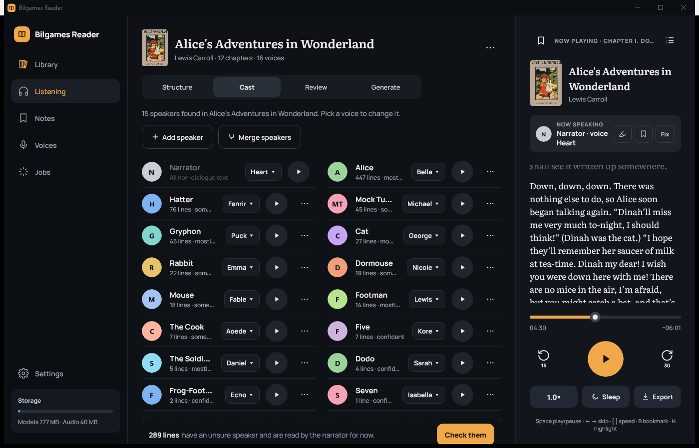
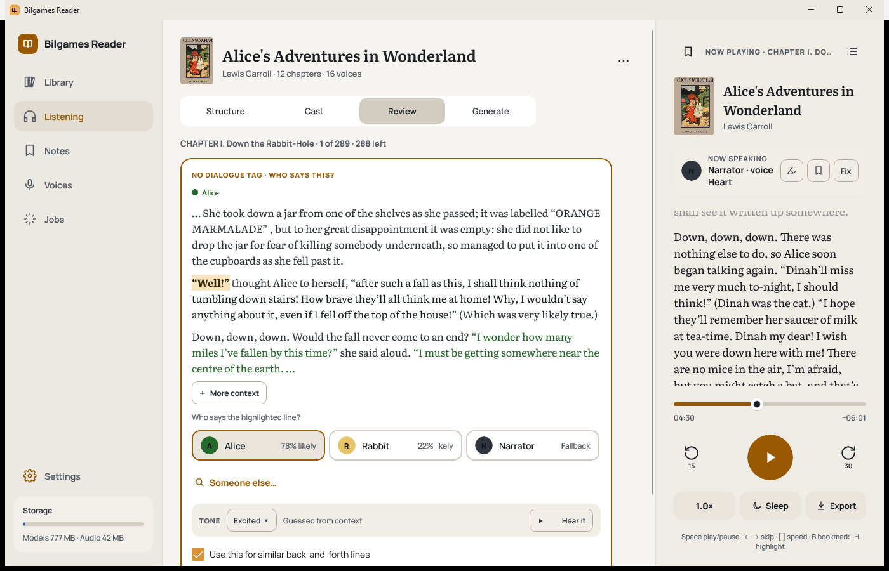
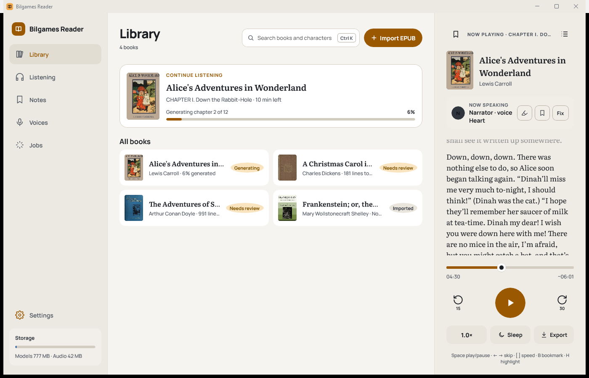
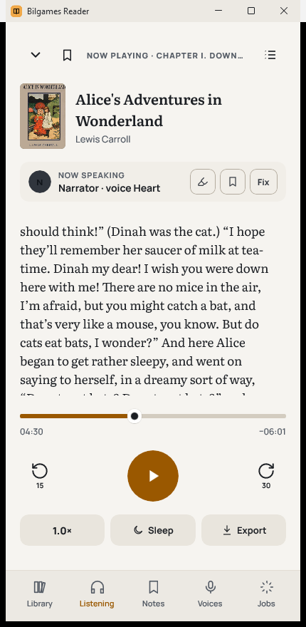
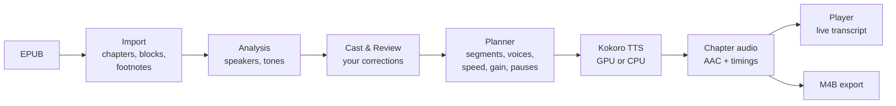

# Bilgames Reader

**Turn your DRM-free EPUBs into full-cast audiobooks, on your own PC.**

Bilgames Reader reads a book, works out who says each line, gives every character their own voice,
performs each line in the right tone, and generates a chapter-by-chapter audiobook you can listen to
straight away. Everything happens on your device: after a one-time voice download, no internet
connection is needed and nothing from your books ever leaves your computer.

[](https://github.com/silent-diffusion/Bilgames-Reader/releases/latest)


[](LICENSE)


*[The same introduction with sound](docs/intro/bilgames-intro.html), read by the app's own voices,
and as a [video](docs/intro/bilgames-intro.mp4).*



## Contents

- [Highlights](#highlights)
- [Install](#install)
- [Quick start](#quick-start)
- [Features](#features)
- [Keyboard shortcuts](#keyboard-shortcuts)
- [System requirements](#system-requirements)
- [Privacy](#privacy)
- [Your data](#your-data)
- [Troubleshooting](#troubleshooting)
- [Roadmap](#roadmap)
- [For developers](#for-developers)
- [Contributing](#contributing)
- [License and credits](#license-and-credits)

## Highlights

- **A voice for every character.** Speakers are found automatically; you can review uncertain lines,
  add, merge and rename characters, and choose from 28 natural English voices.
- **Lines performed in tone.** Whispers, shouts, sad or amused lines are read with matching pace,
  loudness and pauses.
- **Listen in seconds, not hours.** The first chapter is ready almost immediately, and any chapter
  plays while it's still being generated.
- **A real audiobook file.** Export an `.m4b` with chapters, cover art, title and author for any
  audiobook player.
- **Bookmarks, highlights and notes**, across all your books, exportable as Markdown, text or CSV.
- **Private and offline.** No account, no cloud, no analytics.
- **Uses your graphics card** when it can, and carries on on the processor when it can't.

## Install

1. Download **`BilgamesReader-win-Setup.exe`** from the
   [latest release](https://github.com/silent-diffusion/Bilgames-Reader/releases/latest).
2. Run it. It installs for your user account only (no administrator rights needed) and adds a
   Start menu entry.
3. The installer isn't code-signed yet, so Windows SmartScreen may say *"Windows protected your PC"*.
   Choose **More info → Run anyway**. (Signing is on the [roadmap](#roadmap).)

Updates are one click: **Settings → Check for updates**. Automatic checking at start-up is available
but off by default. Your library, voices and audio are kept across updates.

## Quick start

1. **Import a book.** Click **Import EPUB** (or press <kbd>Ctrl</kbd>+<kbd>K</kbd> to jump to the
   library) and pick a DRM-free `.epub`. Project Gutenberg books are a good place to start.
2. **Choose what to read.** On the **Structure** tab, decide whether to include front matter, chapter
   headings, back matter and footnotes.
3. **Find speakers.** Click **Find speakers**. The first chapter is done in about a second; the rest
   of the book follows in the background.
4. **Check the cast and voices.** On **Cast**, give characters the voices you like (▶ previews a voice
   with the character's own line). On **Review**, confirm the lines the app wasn't sure about.
5. **Generate and listen.** On **Generate**, click **Generate audio**. The first time, the app
   downloads its voice model (about 156 MB). Press **Listen now** whenever you like: unfinished chapters
   play as they're made.



## Features

### Books and structure

- Imports **DRM-free EPUB 2 and EPUB 3** files. DRM-protected books are refused.
- EPUBs are treated as untrusted files: nothing is extracted to disk, sizes are capped, and XML is read
  without external entities.
- Finds chapters, parts and headings automatically, and separates **front matter**, the **main text**
  and **back matter** (including Project Gutenberg's header and licence).
- Choose whether to read the front matter, **chapter headings** ("Chapter 4. The Rabbit Sends in a
  Little Bill") and back matter.
- **Footnotes** can be read inline, at the end of each chapter, or skipped.
- **Preview extracted text** to see exactly what will be read.
- Shows estimated listening time, storage and word count for every book.

### Speakers

- **Automatic speaker attribution** from dialogue tags ("said Alice"), pronouns, alternation in
  conversations, and action beats.
- **Cast** tab: every character with their line count, colour and voice, sorted by how much they speak.
  - **Add** a character the analysis missed, **merge** names that are the same person, **rename**
    (⋯ → Rename…), **remove**, or keep two characters apart when a merge is suggested.
  - **Show lines** lists everything a character says, with the context expandable step by step.
- **Review** tab: a queue of the lines the app wasn't sure about ("Chapter 4 · 5 of 929 · 924 left").
  - Pick the speaker from the suggestions or recent choices, type a new name to add a character on
    the spot, or skip a line.
  - **More context** expands the surrounding text up to about a dozen paragraphs either side.
  - **Hear it** plays the line with the chosen speaker and tone.
- Your corrections are kept when you run **Find speakers again**: added speakers, merges, renames and
  confirmed lines all survive.

### Voices

- **28 English voices** (Kokoro-82M): American and British, female and male.
- Voice menus are grouped by **gender → nationality**; typing searches all voices ("brit fem" finds
  British female voices).
- Voices already used in the book are marked **In use**, with who has them.
- **▶ Preview** any voice before choosing it.
- Pick the **default narrator** for new books in Settings → Narration.

### Tone

Every dialogue line can carry one of ten tones: whispered, soft, sad, hesitant, amused, excited,
urgent, stern, angry or shouting.

- Tones come from the **dialogue tag** ("she whispered", "he said coldly"), from **context** (capitals
  and "!!" for shouting, stammers and trailing ellipses for hesitation, action beats like "glared" or
  "grinned"), or from **you**: change any line's tone in Review or a character's line list.
- Each tone is performed with its own pace, loudness and pauses.

### Generating audio

- **Quality:** Fast, Balanced (recommended) or High quality, per book.
- **Graphics card or processor:** with *Prefer the GPU* on, generation uses your DirectX 12 graphics
  card when it has free memory, moves to the processor if memory runs short, and moves back when it
  frees up, without stopping. If the GPU is too full, the app shows **which apps are using its memory**.
- **Listen while it generates:** any chapter plays immediately; the one you're listening to is made
  first.
- **Only what changed is redone:** fixing a speaker or a voice regenerates just the affected lines.
- **Resumes** where it left off if the app closes.
- **Battery-aware:** slows down on battery or with energy saver on, to keep the device cool.

### Listening

- **Live transcript** that follows the reading; tap any line to jump there.
- **Now speaking** shows who is talking, with a **Fix** button to correct the speaker on the spot.
- Speed from **0.8× to 2×**, skip back 15 s and forward 30 s, chapter list, and a **sleep timer**
  (15, 30, 45 or 60 minutes, or the end of the chapter).
- Works with **Windows media controls**: keyboard media keys, the Windows media overlay and lock
  screen, and Bluetooth headphones, with the book's title, chapter and cover.
- Remembers where you were in every book, anchored to the words, so it lands on the same sentence even
  after the audio is regenerated.

### Bookmarks, highlights and notes

- <kbd>B</kbd> bookmarks the moment you're hearing; <kbd>H</kbd> highlights the line being read.
- Select text in the transcript to highlight it in one of four colours, add a note, or copy it.
- The bookmarks panel lists everything in the book; play from any item, edit notes, or delete.
- The **Notes** page gathers bookmarks, highlights and notes from **all your books**, with search,
  filters and sorting.
- **Export** as Markdown, plain text or CSV, for one book or everything.

### Exporting audiobooks

- **Export** saves the book as an `.m4b` audiobook with:
  - a **chapter list** that Apple Books, iOS and most audiobook players show;
  - the **cover art**, title, author and genre.
- A progress bar shows how far along it is, and you can stop at any time.
- Export the chapters that are ready now, or wait until the whole book is done.

### Library, backup and moving books



- **Search** books and characters (<kbd>Ctrl</kbd>+<kbd>K</kbd>); **Continue listening** picks up
  where you left off.
- **Delete** just a book's audio (to save space, keeping speakers and voices) or the whole book.
- **Back up your library** to one file (Settings → Backup), with or without audio, and **restore** it
  on this or another PC. Restoring never leaves a half-written book, and your current edits are saved
  first.
- **Book files:** export a single book as a **`.bilgames`** file (book page → ⋯ → Export book file…)
  and import it on another PC with **Import**. Audio that still matches is reused.

### Storage

- **Keep finished audio:** all chapters (default), recent chapters (the one you're on, one before and
  three ahead), or until listened. Removed chapters are made again when you reach them; an export makes
  them first.
- **Keep segment cache** lets a speaker fix regenerate only the changed lines (about 170 MB per hour of
  audio); turn it off or clear it to save space.
- Settings shows how much space voice models and audio use, and opens the data folder.

### Appearance and accessibility

- **Light, dark, or same as Windows**, switching instantly. **Windows contrast themes** are followed
  automatically with the system's own colours.
- **Reading text size** for all book text, on top of Windows' own text size setting.
- **Adapts from phone-width to full-screen windows**: bottom navigation when narrow, a side rail at
  tablet width, and a three-pane layout on wide screens.

  
- Full **keyboard** support and **screen reader** labels throughout.

### Reliability

- Every save is atomic, and edits made while generating can't overwrite each other.
- Updates that change how your library is stored **back it up first**, then upgrade it.
- A damaged file is copied aside and reported, never silently lost.
- Diagnostics go to a small local log, which never includes book text.

## Keyboard shortcuts

| Key | Action |
|---|---|
| <kbd>Space</kbd> | Play / pause |
| <kbd>←</kbd> / <kbd>→</kbd> | Back 15 seconds / forward 30 seconds |
| <kbd>[</kbd> / <kbd>]</kbd> | Slower / faster |
| <kbd>B</kbd> | Bookmark this moment |
| <kbd>H</kbd> | Highlight the line being read |
| <kbd>Ctrl</kbd>+<kbd>K</kbd> | Search the library |
| Media keys | Play/pause, next and previous chapter (previous first restarts the chapter) |

## System requirements

| | Minimum | Recommended |
|---|---|---|
| **Windows** | Windows 10 version 1809 (64-bit) | Windows 11 |
| **Processor** | Any 64-bit x64 CPU | 4 cores or more |
| **Graphics** | Not required | DirectX 12 GPU with about 1.5 GB of free video memory |
| **Disk** | About 500 MB for the app and standard voice model | Plus about 30 MB per hour of finished audio (and about 170 MB per hour while the segment cache is on) |
| **Internet** | Only to download the app, its voice model (156 MB, or 310 MB for High quality) and updates | |

Generation is much faster on a GPU, but every feature works on the processor alone.

## Privacy

- Books, their text, speaker analysis, voices, audio, bookmarks and listening history **stay on your
  device**.
- The app goes online **only** when you click something that needs it: downloading a voice model,
  checking for or installing an update (or if you turn on update checks at start-up).
- **No accounts, analytics, telemetry or crash reports.**
- Only import books you're entitled to use; DRM-protected EPUBs are refused.

## Your data

Everything lives in `%LOCALAPPDATA%\BilgamesReader`:

```text
library.json            library format version
settings.json           your settings
books/{id}/             one folder per book: the original EPUB, text, analysis, cast,
                        bookmarks and highlights, finished audio and the segment cache
backups/                automatic backups taken before a format upgrade or a restore
models/                 voice models
logs/app.log            diagnostics (no book text)
```

**Uninstalling** removes the voice models, caches and logs but keeps your library, so reinstalling
picks up where you left off. Delete the folder above to remove everything.

## Troubleshooting

<details>
<summary><b>Windows says "Windows protected your PC"</b></summary>

The installer isn't code-signed yet. Choose **More info → Run anyway**.
</details>

<details>
<summary><b>It says "Processing on CPU" although I have a graphics card</b></summary>

Generation moves to the processor when the GPU doesn't have enough free memory, and moves back when it
does. The Generate tab and Settings → Processing list the apps using your GPU's memory; closing a game
or another GPU-heavy app usually helps. Check that *Prefer the GPU* is on in Settings → Processing.
</details>

<details>
<summary><b>"This book is DRM-protected"</b></summary>

Bilgames Reader can only read DRM-free EPUBs. Many stores sell DRM-free books, and Project Gutenberg
has tens of thousands of free ones.
</details>

<details>
<summary><b>A line is read by the wrong character</b></summary>

Press **Fix** while it's playing, use the **Review** tab, or reassign it from the character's lines on
the **Cast** tab. Only the changed lines are regenerated. Merging duplicate characters (for example
"Bingley" and "Mr. Bingley") fixes many lines at once.
</details>

<details>
<summary><b>My exported audiobook has no chapters</b></summary>

Make sure you're on version 0.5.2 or later; earlier versions wrote chapters in an older format that most
players ignore. Export the book again after updating.
</details>

<details>
<summary><b>Where are the logs?</b></summary>

`%LOCALAPPDATA%\BilgamesReader\logs\app.log`. They never contain book text, so they're safe to attach
to a bug report.
</details>

## Roadmap

Planned work, roughly in order. **Nothing here is available yet.**

**Toward 1.0 (Windows)**

- **Signed installer**, so Windows no longer warns about an unknown publisher.
- **File associations:** double-click an `.epub` or `.bilgames` file to open it in Bilgames Reader.
- **Better speaker detection:** characters introduced only by description ("the March Hare", "the
  captain"), nicknames in address ("…, Lizzy"), and speaker labels in plays ("ROMEO.").
- **Fewer lines to review**, by linking names such as "Bingley" and "Mr. Bingley" automatically.

**After 1.0**

- **Bilgames Reader for Apple devices:** one app for iPhone, iPad and Mac that opens the same library
  and `.bilgames` book files, starts playing within seconds with a fast voice, and generates the rest in
  the background.
- **Syncing** listening positions, bookmarks and notes between devices.
- **Expressive voices (on hold):** an optional, slower engine with genuine emotional delivery,
  under evaluation.

Known limitations today: English only; plays and poetry are read by the narrator; the installer is
unsigned.

## For developers

### Build and run

Requires the **.NET 10 SDK** (pinned in `global.json`) on Windows 10 1809 or later.

```powershell
dotnet test tests/Bilgames.Core.Tests
dotnet build src/Bilgames.App -p:Platform=x64
src/Bilgames.App/bin/x64/Debug/net10.0-windows10.0.19041.0/win-x64/BilgamesReader.exe
```

Set `BILGAMES_DATA` to another folder to run against a scratch library without touching your own.
`.epub` and `.bilgames` paths passed on the command line are imported (a second launch hands them to
the running window).

### Project layout

| Path | What it is |
|---|---|
| `src/Bilgames.Core` | Platform-free engine (plain `net10.0`): EPUB import, chapter detection, speaker and tone analysis, synthesis planning, the generation job, chapter streaming, audio retention, storage, format migrations, backups and M4B writing. |
| `src/Bilgames.Tts.Kokoro` | Kokoro-82M text-to-speech on ONNX Runtime with DirectML (via KokoroSharp), GPU memory monitoring, and the model downloader. |
| `src/Bilgames.App` | WinUI 3 app (Windows App SDK 1.8): adaptive layout, player, settings, updates (Velopack). |
| `tests/Bilgames.Core.Tests` | xUnit tests, including golden-file conformance tests. |
| `tests/corpus` | Public-domain Project Gutenberg books used by the tests. |
| `tools/Bilgames.Inspect` | Developer command-line tool (below). |
| `build/release.ps1` | Builds, tests, packages and publishes the installer. |
| `design/` | Design handoff: tokens, product spec and screen prototypes. |

### How it works



- **Plans are content-addressed.** Every segment is hashed from its model, voice, speed and text, so
  only segments whose inputs change are re-synthesized; a chapter whose plan hash changes is reassembled
  from cached segments.
- **Listening while generating** packs finished segments into small chunks on the same timeline as the
  final chapter (`ChapterStream`), so the player can switch to the finished file without a jump.
- **The GPU path** rewrites Kokoro's depthwise ConvTranspose layers for DirectML on first use
  (`ModelPatcher`, numerically equivalent) and runs at full precision; any GPU error or memory shortage
  falls back to the CPU segment by segment.
- **Text anchors:** positions and bookmarks are stored as a line plus a fraction through it
  (`TextAnchors`); seconds are only a cache.
- **Voices** come from the engine (`ITtsEngine.Voices`); a saved voice another engine lacks is played by
  the closest one (`VoiceResolver`). Voice IDs never change because they're part of every segment hash.

### Data format and compatibility

- `library.json` holds a **format version**. Changes go through a migration in `LibraryFormat`, which
  backs up every edit first (`backups/pre-upgrade-*.zip`). Format 2 (0.5.0) added text anchors.
- Fields written by a newer version survive a save (`[JsonExtensionData]`); unknown enum values read as
  defaults (`LenientEnumConverter`); damaged files are copied aside (`*.unreadable-*`).
- Backups and `.bilgames` book files share one zip format (`LibraryBackup`), and restoring treats them as
  untrusted.
- This format will be shared with the planned Apple app, so changes must stay backward-compatible.

### Tests

```powershell
dotnet test tests/Bilgames.Core.Tests
```

The **golden-file tests** import the four books in `tests/corpus/`, analyse and plan them, and compare
the structure, cast, per-line analysis, per-segment plan and hashes with
`tests/Bilgames.Core.Tests/Golden/`, under three cultures (the machine's, de-DE and tr-TR). They are the
conformance spec for any port of the engine. After an intended change, regenerate and review the diff:

```powershell
$env:BILGAMES_UPDATE_GOLDEN = "1"; dotnet test tests/Bilgames.Core.Tests --filter GoldenFile
Remove-Item Env:BILGAMES_UPDATE_GOLDEN
```

A changed segment hash means users' audio for that text is regenerated, so treat it as a breaking change.

### Developer tool

```powershell
dotnet run --project tools/Bilgames.Inspect -- book.epub structure      # chapters and their kinds
dotnet run --project tools/Bilgames.Inspect -- book.epub text 5         # extracted text of chapter 5
dotnet run --project tools/Bilgames.Inspect -- book.epub analyze 5      # speakers and lines
dotnet run --project tools/Bilgames.Inspect -- x m4b book.m4b           # chapters in an exported file
dotnet run --project tools/Bilgames.Inspect -- x gpu                    # apps using GPU memory
dotnet run --project tools/Bilgames.Inspect -- x phonemes "text"        # what the speech front end hears
dotnet run --project tools/Bilgames.Inspect -- x tokens "text" bm_george --out t.json  # Kokoro inputs as JSON
```

### Releasing

```powershell
./build/release.ps1 -Version 0.5.2            # build artifacts/releases/BilgamesReader-win-Setup.exe
./build/release.ps1 -Version 0.5.2 -Publish   # also publish a GitHub release (uses `gh auth token`)
```

Bump `<Version>` in `Directory.Build.props` with each release. Installed copies update from this
repository's GitHub Releases via Velopack, with small delta updates.

## Contributing

Bug reports and ideas are welcome as [GitHub issues](https://github.com/silent-diffusion/Bilgames-Reader/issues).
Please include your Windows version, whether generation runs on the GPU or CPU, and the relevant part of
`logs\app.log`.

- **Never commit copyrighted books.** Only public-domain Project Gutenberg EPUBs belong in
  `tests/corpus/`; `.gitignore` blocks every other `.epub`.
- Keep `Bilgames.Core` free of Windows dependencies and deterministic: culture-invariant formatting, no
  GUIDs or timestamps in anything hashed.
- Run the tests before opening a pull request, and regenerate golden files only for intended changes.

By contributing, you agree that your contributions are licensed under the [MIT License](LICENSE).

## License and credits

Bilgames Reader is open source under the [MIT License](LICENSE): you're free to use, copy, modify and
distribute it, provided the copyright and license notice are kept.

The MIT License covers Bilgames Reader's own code and documentation. Components it uses keep their own
licenses: the voice model, libraries and fonts below (all permissive: MIT, Apache-2.0, BSD-3-Clause, the
SIL Open Font License, or Microsoft's redistributable runtime terms), and the public-domain test books in
`tests/corpus/`, which also carry Project Gutenberg's terms.

Bilgames Reader is built on:

- [Kokoro-82M](https://huggingface.co/hexgrad/Kokoro-82M) voice model and voices (Apache-2.0)
- [KokoroSharp](https://github.com/Lyrcaxis/KokoroSharp) (MIT) and MisakiSharp (Apache-2.0)
- [ONNX Runtime](https://github.com/microsoft/onnxruntime) with DirectML (MIT)
- [Windows App SDK / WinUI 3](https://github.com/microsoft/windowsappsdk), [.NET](https://github.com/dotnet/runtime),
  [CommunityToolkit.Mvvm](https://github.com/CommunityToolkit/dotnet), [Velopack](https://github.com/velopack/velopack)
  and [AngleSharp](https://github.com/AngleSharp/AngleSharp) (MIT)
- [Manrope](https://github.com/sharanda/manrope) and [Literata](https://github.com/googlefonts/literata) fonts (SIL Open Font License)

The full list is in [THIRD-PARTY-NOTICES.txt](THIRD-PARTY-NOTICES.txt), which the app also opens from
Settings → Privacy. The screenshots show public-domain books from [Project Gutenberg](https://www.gutenberg.org/).
The product spec is in [ReadMe.html](ReadMe.html) and the design handoff in [design/README.md](design/README.md).
